<p align="center">
  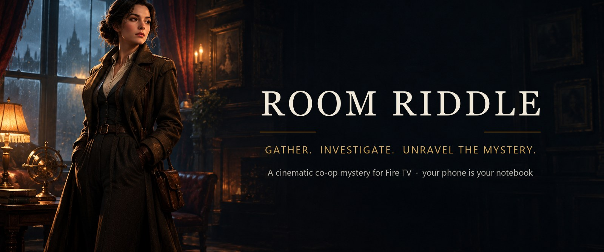
</p>

<p align="center">
  
</p>

<h3 align="center">A cinematic, cooperative mystery game for Amazon Fire TV.<br/>The TV is the crime scene. Your phone is your notebook. The suspects talk back.</h3>

<p align="center">
  <a href="LICENSE"></a>
  
  
  
  
  <a href="https://github.com/perhaps-aksh/RoomRiddle/actions/workflows/ci.yml"></a>
</p>

<p align="center">
  <a href="#-how-it-plays">How it plays</a> ·
  <a href="#-the-cases">The cases</a> ·
  <a href="#-ai-suspects-that-cant-spoil-the-game">AI suspects</a> ·
  <a href="#-quick-start">Quick start</a> ·
  <a href="#-architecture">Architecture</a> ·
  <a href="#-documentation">Docs</a>
</p>

> Built for the **Build, Ship, Shape: Amazon Developer Hackathon** (Fire TV track: family entertainment, multi-modal UX).

---

## ✦ How it plays

<p align="center">
  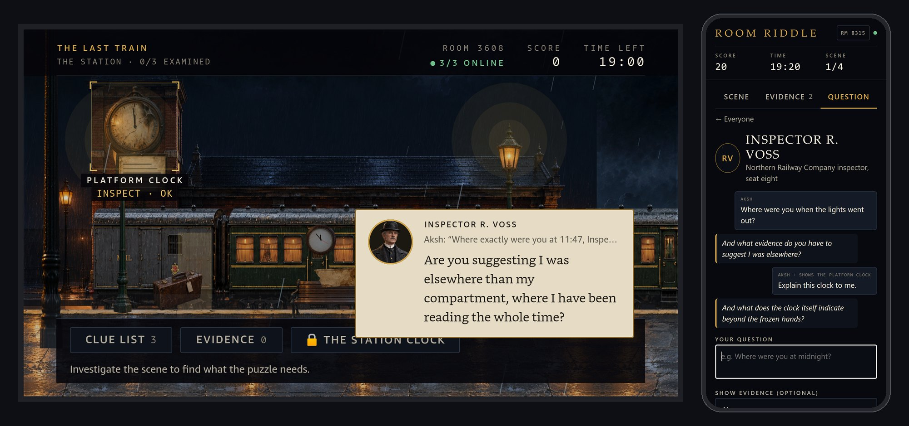
  <br/><sub>Asking Inspector Voss a question from a phone. He answers on the TV, in character, in his own voice, with his painted portrait.</sub>
</p>

1. **Open a room on the TV.** It shows a 4-digit code and a QR code.
2. **Everyone scans it with a phone.** No app to install, no account: a nickname and you're in.
3. **The case opens on the big screen.** A storm-lashed railway platform at 11:52 PM, a conductor missing, a train that leaves at midnight.
4. **Investigate together.** Explore the scene with the remote, examine evidence on your phones, crack puzzles, and spend hints as a team.
5. **Question the suspects.** Type anything. They answer on the TV, but they only know what your group has earned, and some of them lie.
6. **Name the truth.** The game decides which ending your evidence supports.

| | |
|:---:|:---:|
| 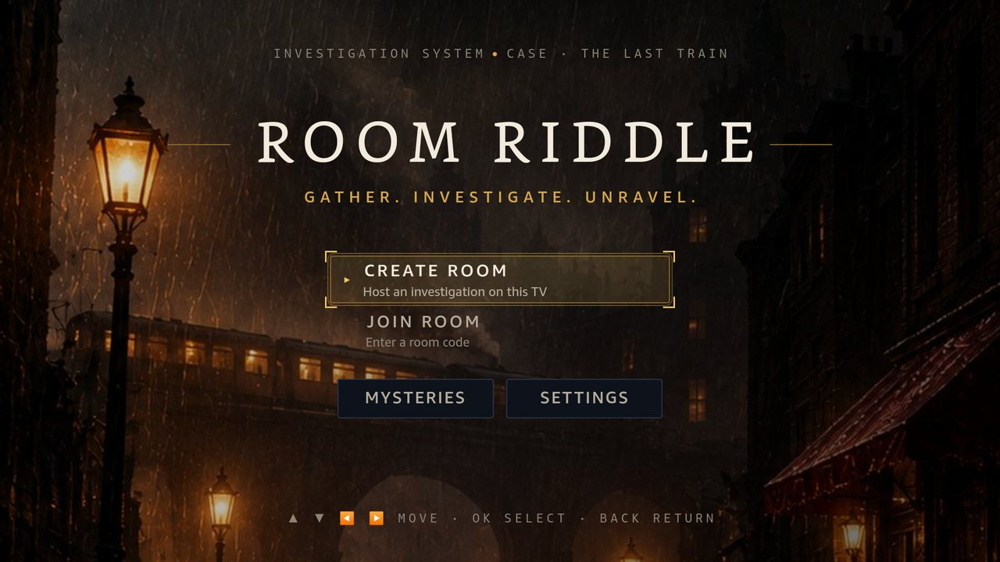 | 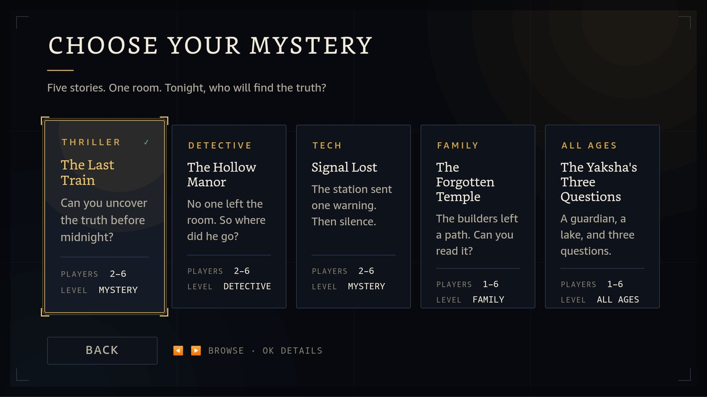 |
| **Home:** create or join a room with the remote | **Library:** five complete cases |
| 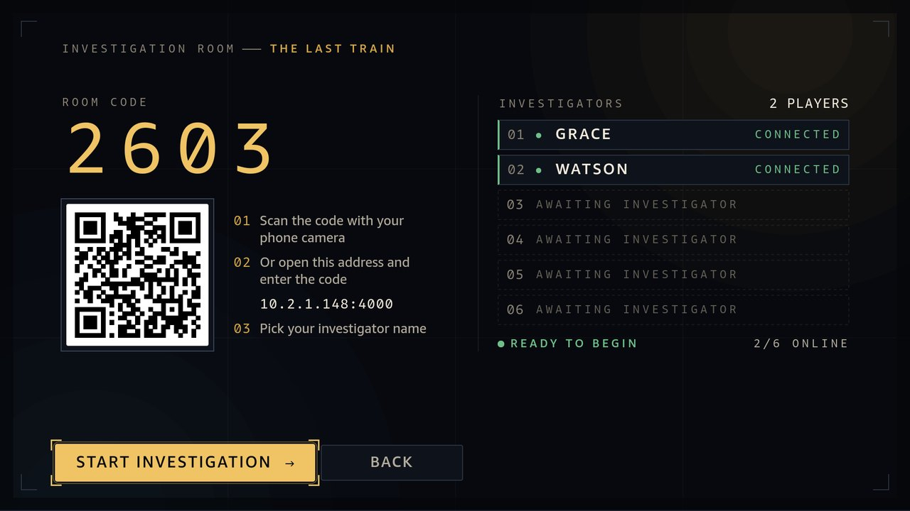 | 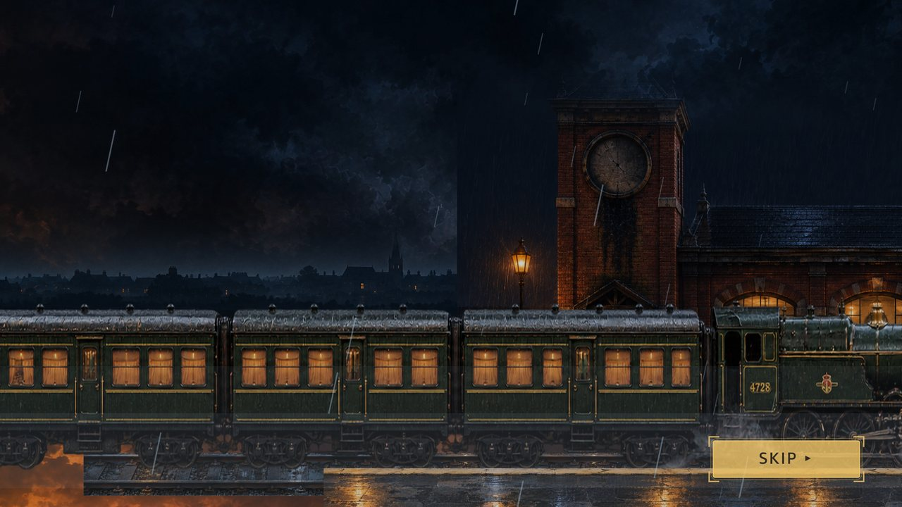 |
| **Lobby:** scan the QR code, see who's in | **Arrival:** the Northern Star pulls in through the rain |

### Inside The Last Train

Painted 2.5D scenes: depth layers move with the camera, rain and steam play over the art, and every clue object sits where it's painted.

| | |
|:---:|:---:|
| 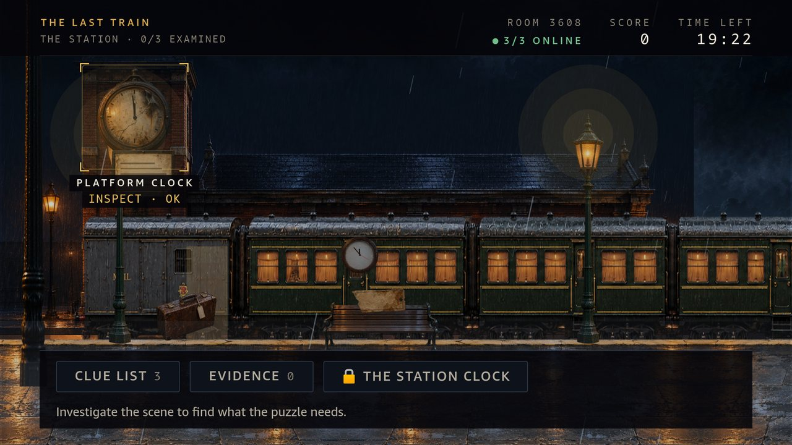 | 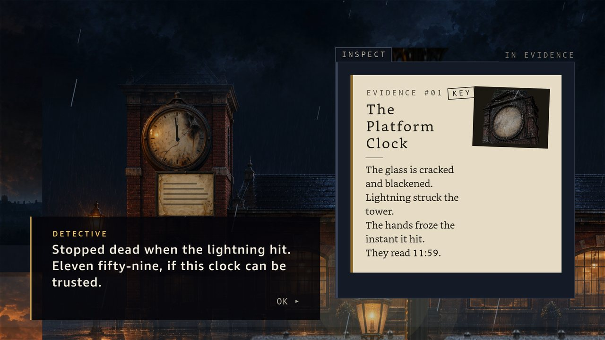 |
| **Platform two:** focus objects with the remote | **Evidence:** every clue has its painted close-up |
| 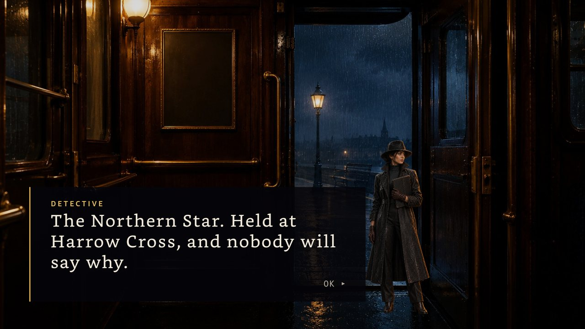 | 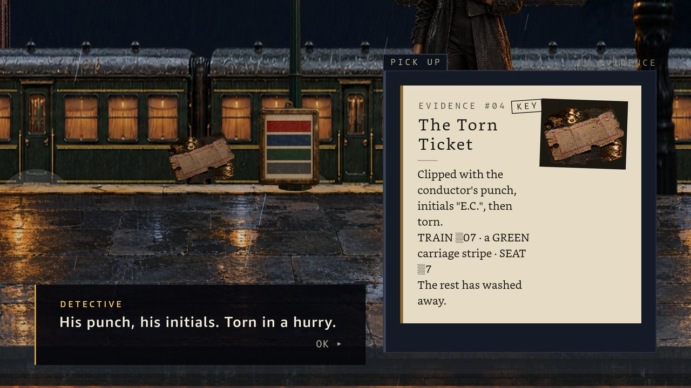 |
| **Detective Grace** narrates and reacts to what you find | **On the platform:** a torn ticket in a puddle |
| 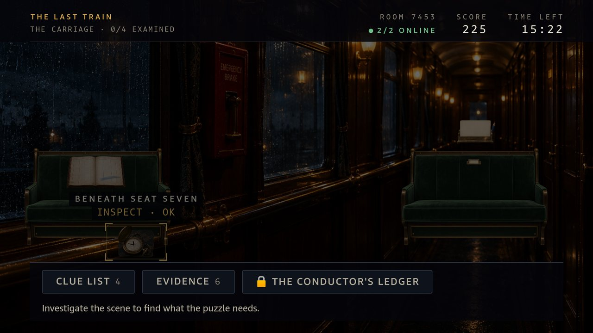 | 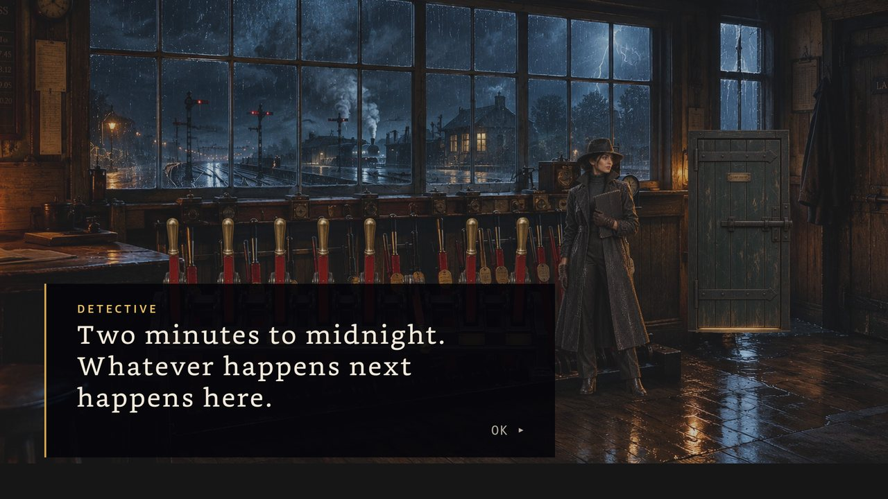 |
| **Carriage C:** the sleeper corridor | **The signal box:** two minutes to midnight |

### Your phone is your notebook

<p align="center">
  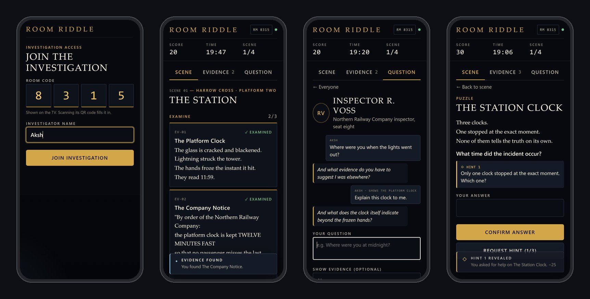
  <br/><sub>Join in seconds · examine evidence · question suspects · solve puzzles with three-step hints</sub>
</p>

---

## ✦ The cases

Every case is a data file: scenes, clues, puzzles, three-level hints, endings and a truth table for every character. The engine knows nothing about any specific mystery.

| Case | Mood | Audience | Length | You'll be doing |
|---|---|---|---|---|
| 🚂 **The Last Train** | Noir thriller, 1930s railway | Teens & adults | 15–25 min | Reading clocks that lie, rebuilding a torn ticket, working out who, where and when from a ledger |
| 🕯️ **The Hollow Manor** | Gothic locked room | Teens & adults | 20–30 min | Locked-room evidence, lining up floor plans, comparing a catalogue |
| 📡 **Signal Lost** | Tech mystery | Teens & adults | 20–30 min | Transcripts, clock-drift correction, root-cause analysis |
| 🛕 **The Forgotten Temple** | Family adventure | Family, 8+ | 15–25 min | Symbol matching, sequences, architecture and history; ends with a preservation choice |
| 🌊 **The Yaksha's Three Questions** | Gentle riddle tale | All ages | 10–20 min | Reasoning riddles, cooperation, symbol order (untimed, no penalties) |

*The Yaksha's Three Questions* is inspired by the *Yaksha Prashna* from the Mahabharata. Its puzzles and story are original, and it is not presented as scripture.

---

## ✦ AI suspects that can't spoil the game

The AI is an **actor, not a judge**. A pure, deterministic game engine decides every outcome. The AI only gives the characters a voice, and only from facts the room has unlocked.

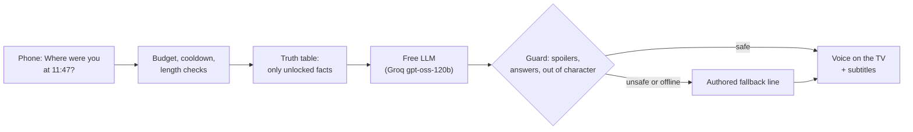

- **Locked facts never reach the model.** The prompt holds only the persona, the unlocked facts and the clues already found.
- **Every reply is checked** for guarded spoilers ("lever 7"), puzzle answers and out-of-character text before anyone sees it. Failures are replaced by authored lines.
- **Evidence matters.** Show a suspect the right clue and the secrets it unlocks become speakable, so their story can change.
- **Free for players.** Free-tier models only, with a per-room question budget, cooldowns and caching. Voices are free neural TTS (Microsoft Edge voices, Groq Orpheus as backup), one fixed voice per character.
- **Optional.** With no keys, or `AI_DISABLED=1`, every case is still fully playable.

<p align="center">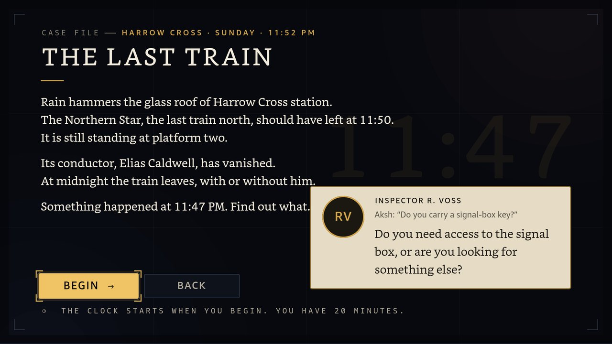</p>

---

## ✦ Features

**On the TV (Vega OS)**
- Remote-first, 10-foot UI with a visible focus frame, readable from the couch; Back never throws progress away without asking.
- Cinematic **2.5D world**: depth-layered scenes, a moving camera, rain, fog, steam and lightning, dialogue and an arrival cinematic.
- A data-driven **audio director**: music states with crossfades, layered ambience, effects, and voice with music ducking.
- Two presentation modes: the cinematic world, or case-file scenes for lower-powered devices and quicker play.
- Settings for volume per channel, subtitles and reduced motion, saved across launches.

**On the phone (web)**
- Join by QR code; each phone is a private notebook with Scene, Evidence and Question tabs.
- Puzzles with exact answer checking (`11:47` = `11 47` = `1147`) and three authored hint levels.
- Live room state: score, time, who found what, and a toast when someone else makes a discovery.
- Survives a dropped connection: you reconnect into the same seat with the current state.

**On the server**
- **Authoritative:** clients send intents ("my answer is 1147"), never results. The server runs the engine and broadcasts the new state.
- Rooms for 2–6 players, host pause when the TV drops, rate limits, frame validation, and no accounts or personal data.
- Answer keys, hint text and truth tables never reach a client before they are earned.

---

## ✦ Quick start

**Requirements:** Node.js 22 or newer, and npm 10 or newer. The TV app also needs the [Vega SDK](https://developer.amazon.com/docs/vega/) on Ubuntu or macOS; it runs on Windows through WSL2, see [docs/development.md](docs/development.md).

```bash
git clone https://github.com/perhaps-aksh/RoomRiddle.git
cd RoomRiddle
npm install
npm run check          # typecheck + all package, server and phone tests
npm run serve          # build the phone app and start the server on :4000
```

**Optional AI and voices:** copy `apps/server/.env.example` to `apps/server/.env` and add a free [Groq API key](https://console.groq.com/keys). Never commit `.env`. Without a key, suspects use authored lines. Spoken lines also need [ffmpeg](https://ffmpeg.org/) on the PATH (or `FFMPEG_PATH`); without it the TV shows subtitles only.

**TV app** (inside Ubuntu or WSL2 with the Vega SDK):

```bash
bash apps/tv/scripts/wsl-check.sh      # typecheck + lint + 80 Jest tests
bash apps/tv/scripts/wsl-build.sh      # build the .vpkg
bash apps/tv/scripts/wsl-install.sh    # install and launch on the Vega Virtual Device
```

- On the Vega Virtual Device the TV reaches the server through `apps/tv/scripts/vvd-bridge.js`.
- On a Fire TV device, point `apps/tv/src/config/server.ts` at `ws://<your LAN IP>:4000/ws`.

**No TV handy?** Run `npm run fake-tv -w @roomriddle/server` to host a headless room, then open the printed join link on your phone or in a browser. `npm run play-bots -w @roomriddle/server -- <code>` plays a scripted game alongside you.

---

## ✦ Architecture

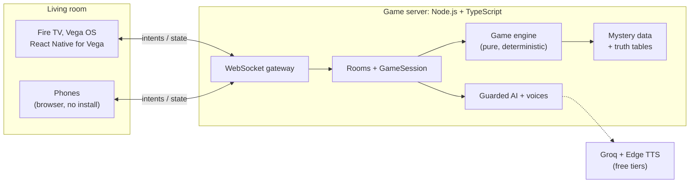

**Ground rules**
- **Data flows one way:** mystery data → game engine → game state → UI.
- **The engine is mystery-agnostic and does no I/O.** Time is passed in, so any game can be replayed from its action log.
- **Presentation is not logic.** The 2.5D world, audio and AI react to the game state; they never decide anything.
- **The protocol lives in one place** (`packages/shared-types`) and is shared by the TV, the phones and the server.

### Repository layout

```
apps/
  tv/             Fire TV app: React Native for Vega (RN 0.83), TypeScript
  player/         Phone app: plain TypeScript + DOM, bundled with esbuild, served by the server
  server/         Authoritative game server: HTTP + WebSocket, rooms, AI and voice gateway
packages/
  shared-types/   Protocol, game state, mystery schema, world and audio types
  game-engine/    Pure rules: applyAction(mystery, state, action) → { state, events }
  mystery-data/   The five cases: scenes, clues, puzzles, hints, endings, truth tables
  scene/          Camera, director, layout, asset registry, audio director
  client/         Protocol client shared by the TV and phones (reconnects, message reassembly)
  ui/             Design tokens: colour, type, spacing, motion
docs/             System design, development, testing, game design, friction log, research
```

The full technical reference is in **[docs/system-design.md](docs/system-design.md)**: the engine, the truth-table model, the multiplayer protocol, the 2.5D renderer, audio and the AI layer.

### Built with

| Layer | Technology |
|---|---|
| TV | React Native for Vega 0.83 · Vega SDK · `@amazon-devices/react-native-w3cmedia` (audio + Media Source) · Async Storage |
| Phone | TypeScript · DOM · esbuild · QR join |
| Server | Node.js · TypeScript · `ws` · ffmpeg (voice clips to fragmented MP4) |
| AI | Groq `openai/gpt-oss-120b` · Groq Orpheus TTS · Microsoft Edge neural TTS (`msedge-tts`) |
| Quality | `node:test` + `tsx` · Jest + React Native Testing Library · ESLint · GitHub Actions |

---

## ✦ Quality

- **About 325 automated tests:** 58 engine, 22 content, 52 scene, 19 client, 4 UI tokens, 78 server, 11 phone and 80 TV.
- **Every case is played to the end automatically.** Content validation fails the build on unreachable scenes, broken references, puzzles that need clues from later scenes, and spoilers that could never unlock.
- **Spoiler-attack tests** run against the AI guard and the prompt builder.
- **Scripted device QA:** the Vega Virtual Device is driven with remote key presses and screenshots, with an audio trace sink.
- CI runs the root checks on every push and pull request.

---

## ✦ Status

| Area | State |
|---|---|
| Game engine, five playable cases, truth tables | ✅ Done, tested |
| Multiplayer server: rooms, QR join, reconnection, host pause | ✅ Done, tested |
| Phone app: Scene, Evidence and Question tabs | ✅ Done, tested |
| TV app: screens, lobby, settings, library, 2.5D world, audio | ✅ Done, verified on the Vega Virtual Device |
| AI suspect questioning with voices on the TV | ✅ Done, verified on the Vega Virtual Device |
| Painted art for The Last Train, portraits, clue close-ups, menu key art | ✅ Done, verified on the Vega Virtual Device |
| Art for the other four cases, video loops, final audio | 🎨 In progress |
| UI redesign to the final art direction | 🎨 In progress |
| AI hints and narrator | 🔜 Next |
| Validation on Fire TV Stick hardware | 🔜 Next |
| Playable web demo | 🔜 Planned |

**Known limitations:** server state is in memory, so a restart ends all rooms. Audio on the Vega Virtual Device crackles on our development machine; this comes from the emulator, not the app (see [FL-013](docs/friction-log.md)).

---

## ✦ Documentation

| Document | What's inside |
|---|---|
| [docs/system-design.md](docs/system-design.md) | Architecture, engine, content model, protocol, TV renderer, audio, AI, security |
| [docs/development.md](docs/development.md) | Environment setup, Vega SDK under WSL2, the daily loop |
| [docs/testing.md](docs/testing.md) | Test strategy, suites and commands |
| [docs/game-design.md](docs/game-design.md) | Game design notes |
| [docs/architecture.md](docs/architecture.md) | Design decisions, phase by phase |
| [docs/friction-log.md](docs/friction-log.md) | Verified problems we hit with Vega, the emulator and tooling, with workarounds |
| [docs/research/market-research.md](docs/research/market-research.md) | Audience, family impact, market and validation plan |
| [CONTRIBUTING.md](CONTRIBUTING.md) | How to contribute, conventions, and how to write a new case |
| [CHANGELOG.md](CHANGELOG.md) | What changed, milestone by milestone |
| [CREDITS.md](CREDITS.md) | Art, voices, fonts and third-party services |

---

## ✦ License

[MIT](LICENSE) © 2026 Chitraksh Kumar.

Fire TV, Vega OS and Amazon are trademarks of Amazon.com, Inc. or its affiliates. Room Riddle is an independent hackathon project and is not endorsed by Amazon.
