# Room Riddle: system design

The technical reference: how the pieces fit, the rules they follow, and why. For setup see [development.md](development.md); for per-phase decisions see [architecture.md](architecture.md).

## Contents
- [System architecture](#system-architecture)
- [Repository layout](#repository-layout)
- [The game engine](#the-game-engine)
- [Mystery content model and truth tables](#mystery-content-model-and-truth-tables)
- [Multiplayer](#multiplayer)
- [TV app on Vega OS](#tv-app-on-vega-os)
- [Audio system](#audio-system)
- [AI layer](#ai-layer)
- [Expandable mystery library](#expandable-mystery-library)
- [Security and privacy](#security-and-privacy)
- [Testing and quality](#testing-and-quality)
- [Performance](#performance)

## System architecture

### Context

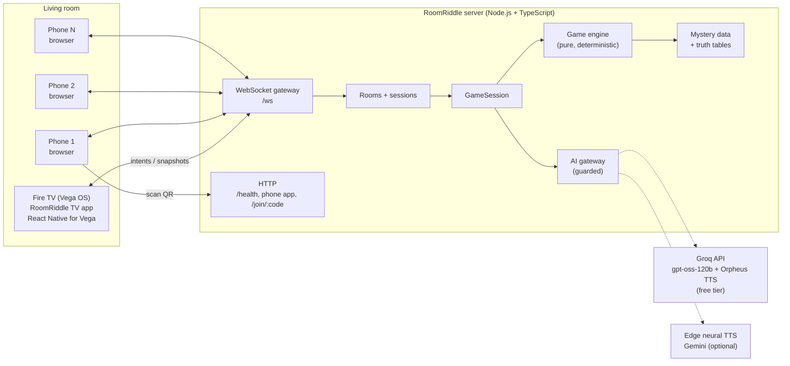

Dashed edges are optional cloud calls. With no keys the game still plays: suspects fall back to authored lines.

### Layers

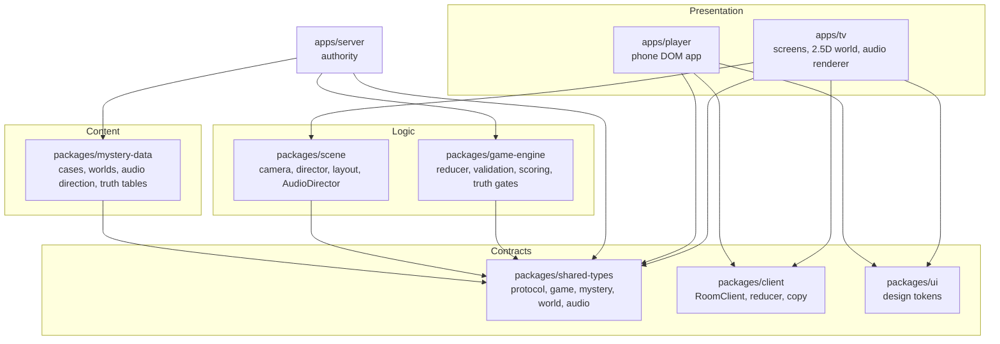

Rules:
- **Data flows one way:** `Mystery Data → Game Engine → GameState → UI`.
- **Clients send intents, never results.** A phone sends "my answer is 1147", never "I solved it".
- **The engine is mystery-agnostic.** No case id appears in engine or UI code; everything specific is data.
- **The engine does no I/O and never reads a clock.** Time is passed in, so any game replays from its action log.
- **Presentation is not logic.** The 2.5D world and the audio system react to `GameState`; they never decide anything.

---

## Repository layout

```
apps/
  tv/             Vega OS TV app (React Native for Vega 0.83, TypeScript). Not an npm workspace (Vega SDK is Linux/macOS).
  player/         Phone companion: plain TypeScript + DOM, bundled by esbuild, served by the server.
  server/         Authoritative game server: HTTP + WebSocket (ws), rooms, sessions, QR, AI gateway.
packages/
  shared-types/   Single source of truth: protocol, game state, mystery schema, world and audio types.
  game-engine/    Pure deterministic rules: applyAction(mystery, state, action) → {state, events}.
  mystery-data/   Authored cases: scenes, clues, puzzles, hints, endings, worlds, audio direction, truth tables.
  scene/          Framework-free presentation logic: camera, director, layout, assets, AudioDirector.
  client/         Framework-free protocol client shared by TV and phone.
  ui/             Design tokens (colour, type, spacing, motion) for TV and phone.
docs/             Architecture, development, game design, testing, friction log, research.
```

---

## The game engine

`packages/game-engine` is a pure reducer.

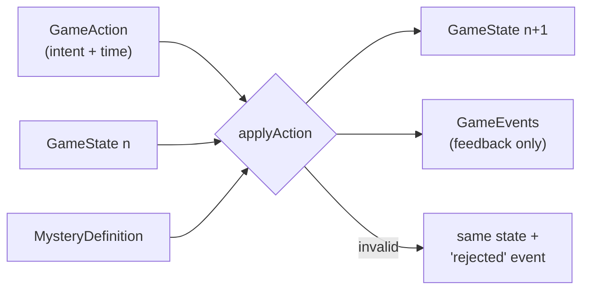

- **Actions:** `START_MYSTERY`, `ADVANCE_SCENE`, `DISCOVER_CLUE`, `OPEN_PUZZLE`, `CLOSE_PUZZLE`, `SUBMIT_ANSWER`, `REQUEST_HINT`, `MAKE_CHOICE`, `PAUSE`, `RESUME`, `TICK`, `COMPLETE_MYSTERY`.
- **Invalid actions never throw.** They return the unchanged state plus a `rejected` event, so a stale or duplicated phone message is harmless.
- **Answer validation is exact.** Input kinds: `digits` (`11:47` = `11 47` = `1147`), `choice`, `combination` (one option per field, also used for ordering and matching) and `text` (case, spacing and punctuation folded, then exact match). No fuzzy matching.
- **Scoring, hints, timers and endings are data.** Hints are three authored levels (nudge, connect, explain). Endings are ordered condition lists; the first match wins.
- **State is plain JSON** with a schema version: saved, broadcast, and rebuilt with `replay(mystery, actions)`.

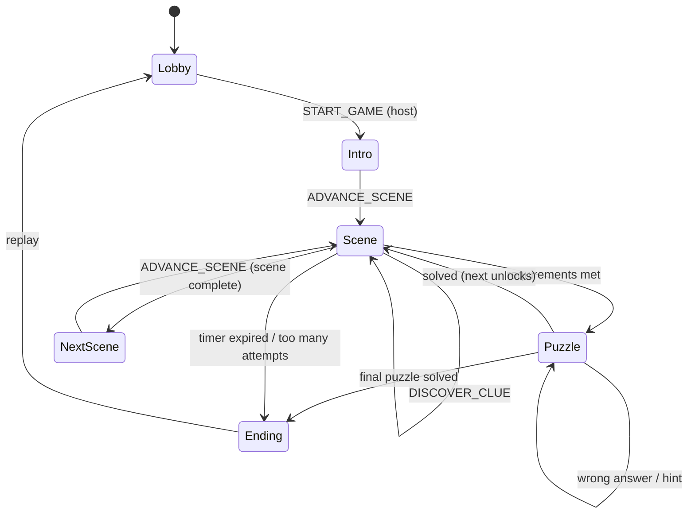

---

## Mystery content model and truth tables

Every case is a `MysteryDefinition` (TypeScript data in `packages/mystery-data/<case>/`):

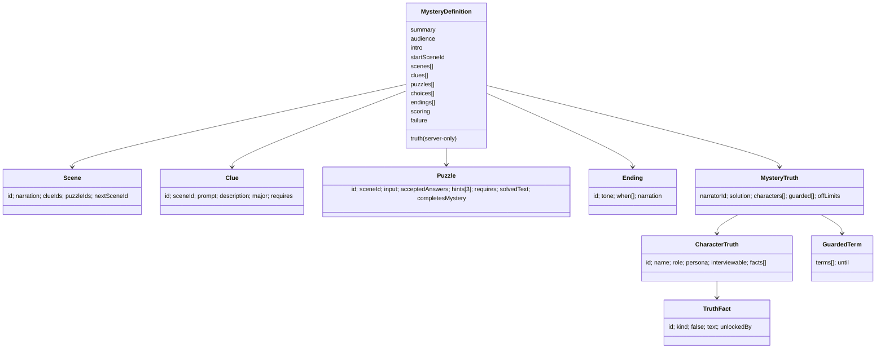

**Truth tables** are the authored ground truth for each character:
- a **claim** is what they say publicly (and may be flagged false);
- a **secret** is true but only becomes speakable once its `unlockedBy` requirement (clues found, puzzles solved) holds;
- **guarded terms** are spoilers ("11:47", "lever 7") that no voice may say until the room has earned them.

The engine exposes pure gates over them: `speakableFacts`, `lockedFacts`, `activeGuardedTerms`, `spoilersIn`. The truth table is stripped from everything sent to clients (`toPublicMystery`), and game rules never read it.

`validateMysteryDefinition` runs in tests for every playable case. It fails the build on unreachable scenes, unknown ids, malformed answers, puzzles that need clues from later scenes, broken truth-table references, secrets that are never locked, and guarded terms that can never unlock.

---

## Multiplayer

### Server components

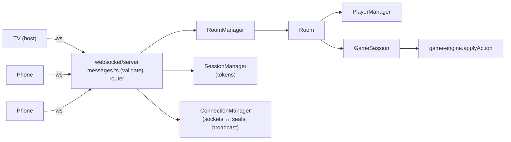

### Protocol

`packages/shared-types/src/protocol.ts` is the single source of truth.

| Direction | Messages |
|---|---|
| Client → server | `CREATE_ROOM`, `JOIN_ROOM`, `RECONNECT`, `LEAVE_ROOM`, `READY`, `START_GAME`, `DISCOVER_CLUE`, `OPEN_PUZZLE`, `CLOSE_PUZZLE`, `SUBMIT_ANSWER`, `REQUEST_HINT`, `ADVANCE_SCENE`, `MAKE_CHOICE` |
| Server → client | `ROOM_CREATED`, `ROOM_JOINED`, `RECONNECT_SUCCESS`, `ROOM_STATE`, `PLAYER_JOINED/UPDATED/LEFT`, `GAME_STARTED`, `GAME_STATE_UPDATED`, `GAME_COMPLETED`, `LEFT_ROOM`, `ROOM_CLOSED`, `ERROR` |

Every server message carries `serverTime`; replies echo the request's `requestId`.

### A turn, end to end

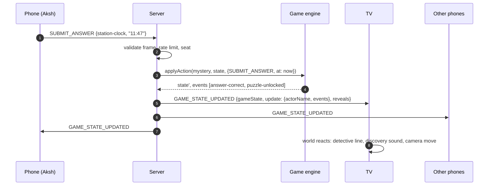

### Joining and reconnection

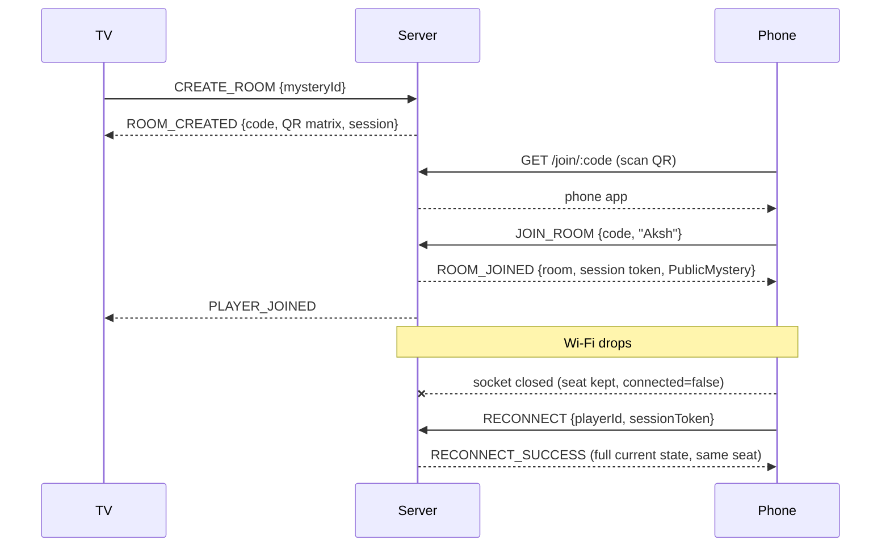

- Room codes: 4 random digits (`crypto.randomInt`), unique among live rooms.
- Session tokens: random 32 bytes, compared in constant time; a newer connection for a seat closes the older one.
- If the **host TV** drops, the game pauses (the clock stops) and phones show "waiting for the TV". A room whose host is gone for 10 minutes closes.
- Limits: 2–6 phone players, 200 rooms, per-connection rate limit, 10 s heartbeats. State is in memory by design.
- Vega's WebSocket client can split one message across several `onmessage` events (FL-011); `RoomClient` reassembles them.

---

## TV app on Vega OS

### Platform features used

| Vega / Fire TV capability | How RoomRiddle uses it |
|---|---|
| React Native for Vega (RN 0.83) | The whole TV app |
| D-pad focus management (preferred focus, explicit neighbours, focus guides) | Every screen is remote-driven, with a focus frame readable from the couch |
| Back key handling | Back never destroys a room or progress without confirmation |
| W3C media (`@amazon-devices/react-native-w3cmedia`) | Music, ambience, effects and voice through one data-driven backend |
| App lifecycle (foreground/background) | Audio mutes in the background and resumes on return |
| Async storage | Settings persist across launches |
| System fonts (Bookerly, Amazon Ember, Ember Mono) | Three type voices, no bundled fonts |
| Vega Virtual Device + CLI | Scripted device QA (remote keys + screenshots) |
| Planned: Content Launcher / deep links | Open RoomRiddle straight into a case |

### Screens and modes

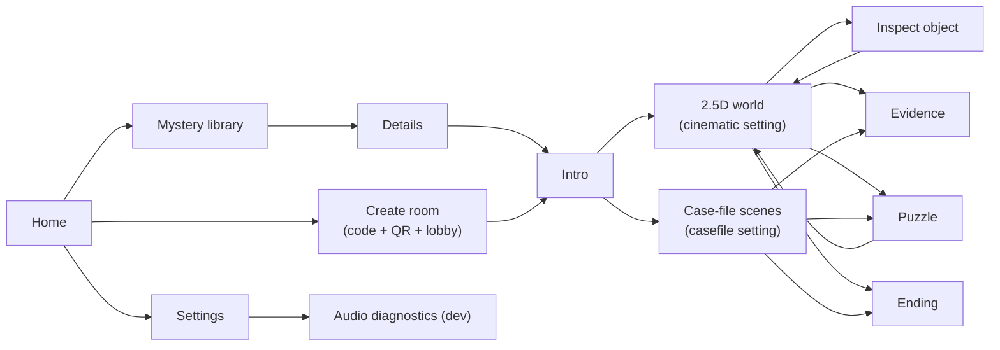

### The 2.5D cinematic world

2D art in depth planes with a camera, not a 3D game, so it stays smooth on a streaming stick.

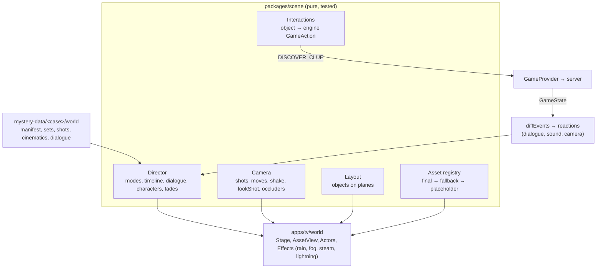

- **Parallax is one rule:** translate = −camera × depth.
- **Assets are swappable by id.** Replacing a placeholder with final art (painted plate, cut-out layer, MP4 loop) only changes the asset map.
- **The world reacts to authoritative state, not to its own input,** so a clue found on a phone produces the same reaction on the TV. Reactions queue behind cinematics.

---

## Audio system

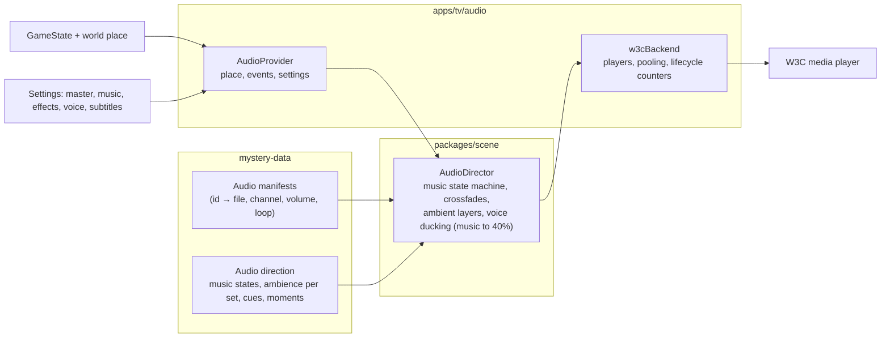

- No component names a file: everything is an id resolved through the manifest.
- Effective volume = master × channel × sound volume (× duck for music under voice).
- A missing file never blocks play: it is logged once (`[AUDIO_MISSING]` with id, reason and scene), voice lines keep their subtitles, music and ambience skip.
- A development trace (`[AUDIO_TRACE]`) logs every command and its cause; `apps/tv/scripts/trace-sink.js` collects it from the device.
- Jest journey tests drive the real provider, director and backend through a whole case and assert order, ducking, cleanup and player counts.

---

## AI layer

**Status:** suspect interrogation is live end to end: phone Question tab → server → guarded model reply → spoken on the TV with subtitles. AI hints and narration are next. Keys live only in `apps/server/.env` (git-ignored). The game remains fully playable without AI.

### What the AI does
1. **Interrogation:** players pick a suspect on their phone and ask anything (typed, or spoken and transcribed). The suspect answers in character on the TV, with voice and subtitles.
2. **Adaptive hints:** the AI rephrases the next authored hint level for the group's situation. It cannot go beyond that level.
3. **Narration:** the narrator (detective, curator or Yaksha) reacts to discoveries and theories.

### What the AI can never do
- Decide whether an answer is correct, unlock anything, or change score or state. Only the engine does.
- See a fact the room has not unlocked. Locked facts are never in the prompt.
- Say a guarded term early. Every reply is checked with `spoilersIn` before anyone sees it.
- Invent evidence. Replies are limited to speakable facts and clues already found.

### Interrogation flow

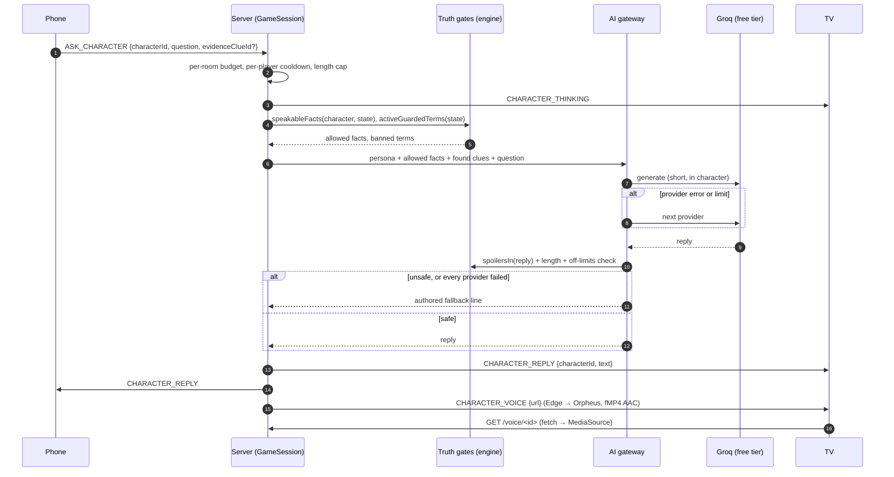

### Cost and reliability
- Free tiers only, in `AI_ORDER` (default Groq `openai/gpt-oss-120b`, measured 0.5–1.2 s per line, then Gemini), then authored lines. Players never pay and never see a key.
- A per-room question budget (30 per playthrough), a per-player cooldown (4 s), short outputs, a 6 s timeout per provider and reply caching keep usage inside free limits. A rate-limited provider rests for a minute; a denied key rests for ten.
- `npx tsx apps/server/scripts/voice-samples.ts <dir>` writes one sample per character to audition the casting.
- `npm run ai-smoke -w @roomriddle/server [groq|gemini]` asks real suspects with the real keys and prints which source answered.

### Code map
| File | Role |
| --- | --- |
| `ai/prompt.ts` | Builds the prompt from persona, unlocked facts (minus any holding a live spoiler) and found clue titles. Player text is fenced. |
| `ai/providers.ts` | Gemini and Groq REST clients (key in headers, never in URLs). |
| `ai/guard.ts` | Strips stage directions, caps at three sentences, rejects spoilers, unsolved typed answers and out-of-character lines. |
| `ai/fallback.ts` | Authored replies from unlocked first-person facts, or a deflection in a tone suited to the case. |
| `ai/voice.ts` | Spoken replies: Edge neural voices (free, no key) via `msedge-tts`, content-addressed in-memory cache, `CHARACTER_VOICE` after the text so subtitles never wait. Each character's voice is data (`CharacterTruth.voice`). |
| `ai/CharacterService.ts` | Budget, cooldown, cache, provider chain, history (last three exchanges per character). Never changes game state. |

### Server settings
| Variable | Default | Meaning |
| --- | --- | --- |
| `GROQ_API_KEY`, `GEMINI_API_KEY` | none | Free-tier keys, in `apps/server/.env` only. |
| `AI_ORDER` | `groq,gemini` | Provider order. |
| `GROQ_MODEL` / `GEMINI_MODEL` | `openai/gpt-oss-120b` / `gemini-3.8-flash` | Models. |
| `AI_DISABLED` | unset | `1` = authored lines only (offline demo). |
| `VOICES_DISABLED` | unset | `1` = subtitles only. |
| `AI_TIMEOUT_MS`, `AI_MAX_QUESTIONS`, `AI_COOLDOWN_MS` | 6000, 30, 4000 | Limits. |
- Voice: server-side free TTS, one fixed voice per character, subtitles always shown. Speech input via Groq Whisper from the phone microphone.

---

## Expandable mystery library

**Status: planned.** Downloaded code cannot safely be executed on the TV, so a mystery pack is **data only**: it describes a case using puzzle types, interactions and effects the installed engine already supports.

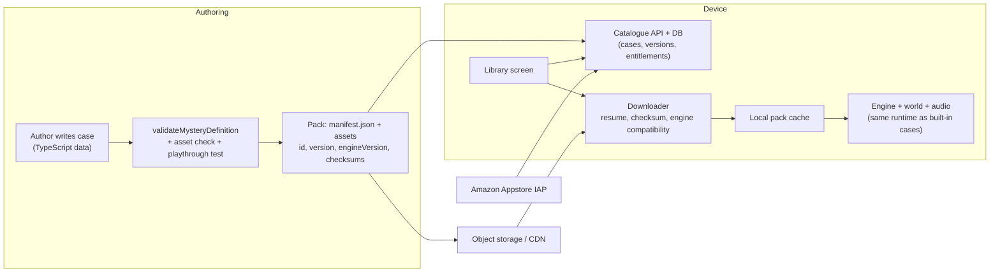

- The server loads the same pack version as the TV before a room starts, so it stays authoritative.
- Packs declare a minimum engine version; incompatible packs are hidden, not crashed.
- Purchases are entitlements verified with the store, separate from downloaded files.

---

## Security and privacy

- Answer keys, hint text, clue descriptions and truth tables never reach a client before they are earned (`PublicMystery` + `GameReveals`).
- Every client frame is shape-validated; unknown fields are dropped; oversize frames are refused; per-connection rate limits apply.
- Session tokens are random 32 bytes, compared in constant time.
- No accounts and no personal data: a player is a nickname for the life of a room. Rooms live in memory.
- API keys are server-side only (`.env`, git-ignored). Questions go to the AI provider without names or identifiers.

---

## Testing and quality

| Suite | Runner | Covers |
|---|---|---|
| `packages/*`, `apps/server`, `apps/player` | `node:test` via `tsx` (`npm run check`) | Engine rules, scoring, validation, playable cases end to end, content validation, scene/camera/director/audio director, protocol, rooms, reconnection |
| `apps/tv` | Jest + React Native Testing Library (`wsl-check.sh`) | Navigation, screens, world, settings, speech bubble, full audio journey through the real game (75 tests) |
| Device | Vega Virtual Device scripts | `vvd-shot.sh` (remote keys + screenshots), `vvd-load.sh` (CPU), audio capture to WAV (`vvd-wav-start.sh`), audio trace sink |
| Lint / types | `tsc --noEmit`, ESLint | All workspaces |

About 320 automated tests (244 package/server/phone + 75 TV) run before every commit. See `docs/testing.md`.

---

## Performance

Measured on the Vega Virtual Device (4 vCPU, software rendering), so these are upper bounds:

| Situation | System CPU |
|---|---|
| Idle VVD | ~13% |
| Static screen, reduced motion | ~5% |
| World exploration | 56–62% |
| Arrival cinematic | ~75% |
| Memory | ~600 MB of 3.9 GB |

Every animation uses the native driver and the frame loop runs only while something moves. Real hardware composites on the GPU and will be measured on a Fire TV Stick.
